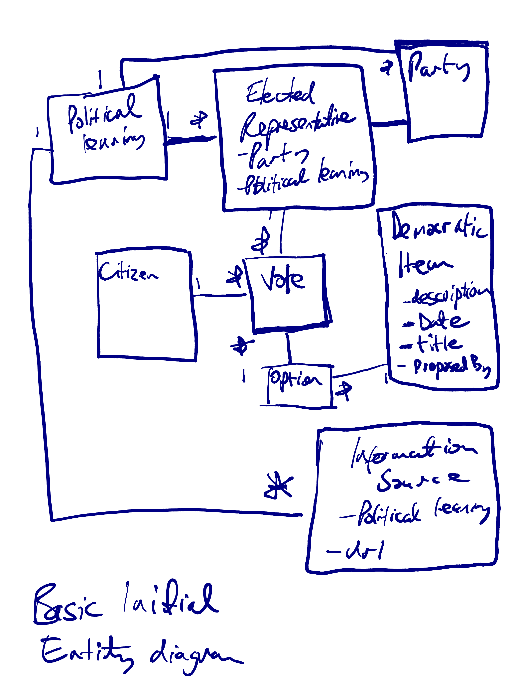
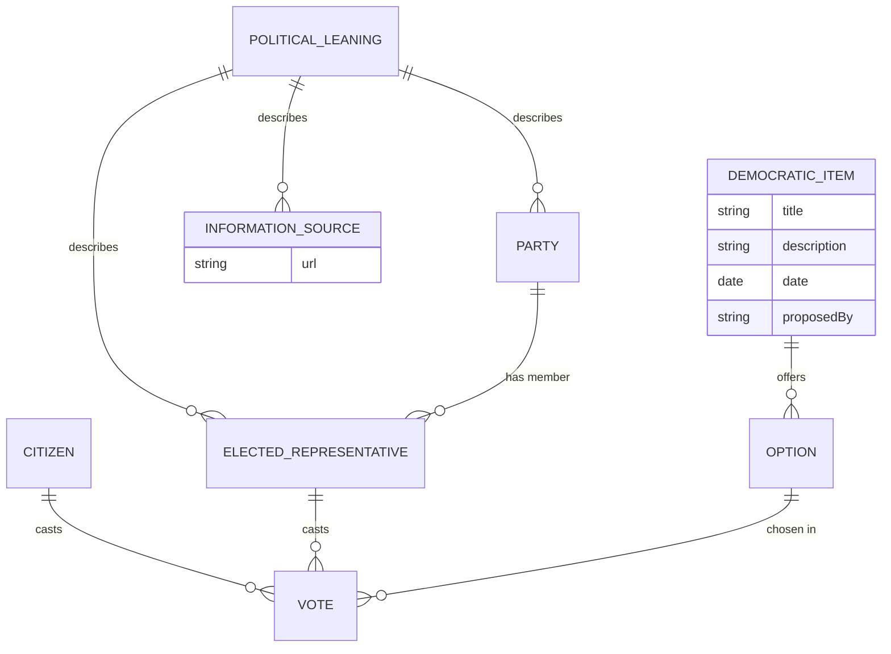

# Prosocial democracy 

## Purpose & motivation
_Why are we building this? What problem does it solve?_

The utopian ideals of the early internet have died.
Social media is anti-social.
People are alienated from the democratic process.

This project is part of a movement of pro social technology, focusing on radical transparency and hyper democracy.
It aims to enable citizens to vote on the democratic agenda in real time, 
view the voting preferences of their peers and their voted representatives. It is an online tool made to try to get people to engage politically in the offline world.

The idea is this will encourage citizens to be better informed, feel empowered as an informed member of the electorate, and aware of whether their elected representatives are aligned with them. This should also encourage people to consider politics on a policy basis rather than by tribal loyalties to any particular party. 

## Goals & success criteria
_How will we know it's successful?_

An active user base.
High quality integrations and data sets.
High conversion to offline activity.
Patreon support
Entertaining and educational

## Scope 
_What's in scope, out of scope, and deliberately deferred?_
## Users & use cases 
_Who is it for, and what do they need to do?_
Citizens need:
- A feed of the democratic agenda (what is being voted on in parliament or other global democratic issues)
- Items should have a link to reading material _(this is potentially contentious as could reveal a bias. Maybe try a link to left/right & center source?? With a note on fallability and flexibility of these terms due to a shifting Overton Window)_
- They should be able to vote on the item.
- They should be able to view how their peers vote (anonymized??), and how their elected representative votes.
- Based on a citizens voting preferences they can see which elected representatives represent them best.
- They should be encouraged towards how to engage with their chosen politics offline.

Need for other types of user e.g. elected representative? Or are we all citizens?
## Functional requirements 
_What must the system do?_
- Auth and accounts
- Read democratic agenda from sources (tbd)
- Record voting record of users
- Record voting record of elected representatives
- Show information sources to educate on each item
- Display a feed of democratic items

## Non-functional requirements 
_Performance, security, reliability, accessibility, maintainability, etc._
- Engaging browser based gui suitable for desktop or mobile
- Not hacky/full of adverts, clean UX
- User is not the product but also not paid for by subscription, funding can finally come from optional patreon support
- Hexagonal architecture. One of the only good arguments I've heard against this is the amount of boiler plate. Now that AI has made writing code so cheap the benefits of maintainability, loose coupling and grokkability outweigh this concern.
- Clean code https://medium.com/jonathans-musings/clean-code-in-the-age-of-ai-fc00d204d3e4
- Strong CI/CD test coverage
- The aim of prosocial media is not to keep peoples attention hooked on the platform but to use it as a tool to get them offline. So there should be encouragement to offline engagement.

# Technical architecture 
_Major components, interfaces, data flows, architectural decisions._

TBD and up for debate, but current assumption would be:
- 3 tier 
- Front end
- Monolith API with many integrations
- Database

# Data model 
_Key entities, relationships, storage and retention requirements._

Basic data model diagram:

fig 1: 

fig 2: the same model as a Mermaid diagram (renders on GitHub, editable as text):

# Tooling & technology
_Languages, frameworks, databases, infrastructure, development tools._
- The author is tooling agnostic, use the best tool for the job
- Favour open source
- Maybe statically typed back end (?) to enable AI development.
- Try not to vendor lock in to evil big tech where possible.

# Testing & quality 
_Testing strategy, coverage expectations, acceptance criteria._
- Strong test coverage.
- Runs in CI/CD 
- Automated linting, formatting
# Deployment & operations 
_Environments, CI/CD, monitoring, backups and recovery._
- Working by default 
- Monitoring and alerts should be in place with good tracing.
- Bugs should be fixed as they come up.

# Constraints & assumptions
_Budget, time, dependencies, regulatory requirements, known limitations._
- Where will we source data from?
- Side project open source from volunteer devs, patreon available.

# Open questions & risks 
_Things to investigate or decisions still to make._
- Any other similar projects around?
