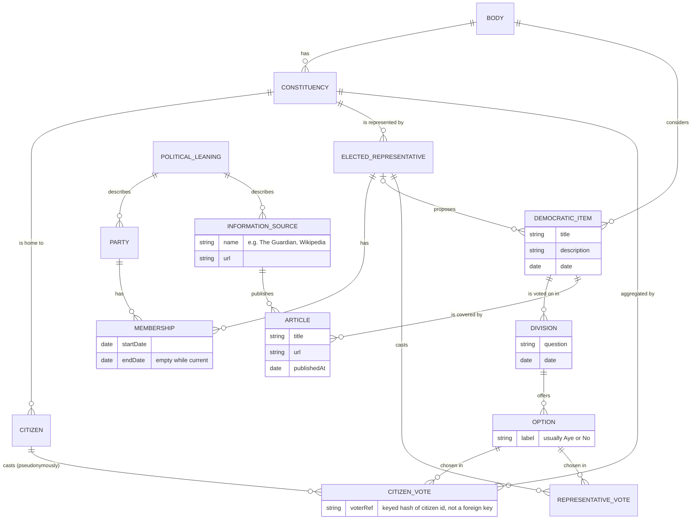

# Prosocial democracy 

## Purpose & motivation
_Why are we building this? What problem does it solve?_

The utopian ideals of the early internet have died.
Social media is anti-social.
People are alienated from the democratic process.

This project is part of a movement of pro social technology, focusing on radical transparency and hyper democracy.
It aims to enable citizens to vote on the democratic agenda in real time, 
view the voting preferences of their peers and their voted representatives. It is an online tool made to try to get people to engage politically in the offline world.

The idea is this will encourage citizens to be better informed, feel empowered as an informed member of the electorate, and aware of whether their elected representatives are aligned with them. This should also encourage people to consider politics on a policy basis rather than by tribal loyalties to any particular party. 

## Goals & success criteria
_How will we know it's successful?_

An active user base.
High quality integrations and data sets.
High conversion to offline activity.
Patreon support
Entertaining and educational

## Scope 
_What's in scope, out of scope, and deliberately deferred?_
## Users & use cases 
_Who is it for, and what do they need to do?_
Citizens need:
- A feed of the democratic agenda (what is being voted on in parliament or other global democratic issues)
- Items should have a link to reading material _(this is potentially contentious as could reveal a bias. Maybe try a link to left/right & center source?? With a note on fallability and flexibility of these terms due to a shifting Overton Window)_
- They should be able to vote on the item.
- They should be able to view how their peers vote (anonymized??), and how their elected representative votes.
- Based on a citizens voting preferences they can see which elected representatives represent them best.
- They should be encouraged towards how to engage with their chosen politics offline.

Need for other types of user e.g. elected representative? Or are we all citizens?
## Functional requirements 
_What must the system do?_
- Auth and accounts
- Read democratic agenda from sources (tbd)
- Record voting record of users
- Record voting record of elected representatives
- Show information sources to educate on each item
- Display a feed of democratic items

## Non-functional requirements 
_Performance, security, reliability, accessibility, maintainability, etc._
- Engaging browser based gui suitable for desktop or mobile
- Not hacky/full of adverts, clean UX
- User is not the product but also not paid for by subscription, funding can finally come from optional patreon support
- Hexagonal architecture. One of the only good arguments I've heard against this is the amount of boiler plate. Now that AI has made writing code so cheap the benefits of maintainability, loose coupling and grokkability outweigh this concern.
- Clean code https://medium.com/jonathans-musings/clean-code-in-the-age-of-ai-fc00d204d3e4
- Strong CI/CD test coverage
- Privacy by design: citizen political opinions are special category data, see Data model → Citizen data protection.
- The aim of prosocial media is not to keep peoples attention hooked on the platform but to use it as a tool to get them offline. So there should be encouragement to offline engagement.

# Technical architecture 
_Major components, interfaces, data flows, architectural decisions._

TBD and up for debate, but current assumption would be:
- 3 tier 
- Front end
- Monolith API with many integrations
- Database

# Data model 
_Key entities, relationships, storage and retention requirements._

fig 1: Basic entity relationship diagram:

Notes:
- A democratic item (usually a bill) is voted on in one or more divisions (second reading, amendments, third reading). Citizens vote on the same divisions as MPs so comparisons are like for like.
- CitizenVote and RepresentativeVote are both a kind of vote (an option chosen on a division). They share a common interface in code but are deliberately separate tables: MP votes are public records imported from Parliament, citizen votes are private political opinions.
- Party membership is time-bound, so historical votes stay attributed to the right party when MPs switch.
- An MP's political leaning is not assigned, it is derived from their voting record.
- Articles are found dynamically by searching for coverage of an item from a source with the requested leaning, then cached as Article records.

## Citizen data protection
Citizens' political opinions are special category data under UK GDPR, so protection is designed in:
- **Pseudonymous votes:** CitizenVote stores `voterRef = HMAC(citizenId, key)`, not the citizen id. The key lives outside the database (secrets manager), so a database dump alone can't link votes to accounts. The app can still show users their own votes by computing the ref.
- **Aggregate without identity:** CitizenVote stores the constituency directly, so peer results are computed without touching identities.
- **Aggregates only, with a minimum group size:** individual citizen votes are never shown to anyone but their owner. Peer results are only displayed when a group has at least k votes (start with k = 10), so small groups can't single people out.
- **Data minimisation:** an account holds an email and a constituency. Postcodes are used for the constituency lookup then discarded. No real names required.
- **Explicit consent:** the lawful basis for processing political opinions is explicit consent (UK GDPR Art. 9), asked for clearly at sign-up.
- **User rights:** users can export their votes, and deleting an account deletes its votes.
- **Least-privilege access:** citizen vote tables have their own DB role. Analytics and reporting read only aggregate views. Logs and traces never contain vote content or voterRefs.
- **Encryption:** in transit (TLS) and at rest, including backups.

# Tooling & technology
_Languages, frameworks, databases, infrastructure, development tools._
- The author is tooling agnostic, use the best tool for the job
- Favour open source
- Maybe statically typed back end (?) to enable AI development.
- Try not to vendor lock in to evil big tech where possible.

# Testing & quality 
_Testing strategy, coverage expectations, acceptance criteria._
- Strong test coverage.
- Runs in CI/CD 
- Automated linting, formatting
# Deployment & operations 
_Environments, CI/CD, monitoring, backups and recovery._
- Working by default 
- Monitoring and alerts should be in place with good tracing.
- Bugs should be fixed as they come up.

# Constraints & assumptions
_Budget, time, dependencies, regulatory requirements, known limitations._
- Where will we source data from?
- Side project open source from volunteer devs, patreon available.

# Open questions & risks 
_Things to investigate or decisions still to make._
- Retention: civic apps tend to spike around elections then fade. Favour a low-frequency digest (e.g. weekly) over chasing engagement metrics.
- Verification: how do we ensure one real person, one vote, in the right constituency?
- Privacy: political opinions are special category data under UK GDPR.

## Similar projects
_What already exists, what we can reuse, and how we differ._
- **TheyWorkForYou / WriteToThem** (mySociety, UK): MP voting records and contacting your MP. Read-only, citizens aren't asked for their opinion. Reuse their API and data rather than rebuilding it; possible collaborator.
- **Vote for Policies** (UK): blind policy comparison matched to parties. A one-off quiz at election time, not ongoing per parliamentary vote.
- **Countable** (US): citizens weighed in on bills and compared with their representatives. The closest match; reportedly struggled with retention, worth researching the lessons.
- **Pol.is / vTaiwan / Decidim**: deliberation and participation platforms. Good ideas for showing peer opinion without polarising.

**How we differ:** an ongoing UK loop of agenda item → learn from balanced sources → vote → compare with peers and your MP → take action offline.
